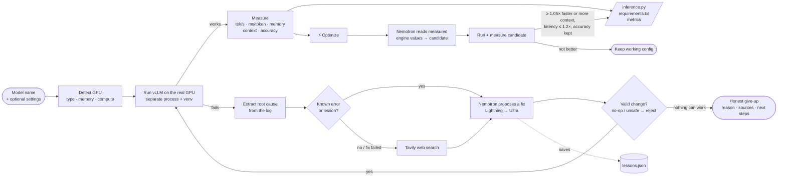
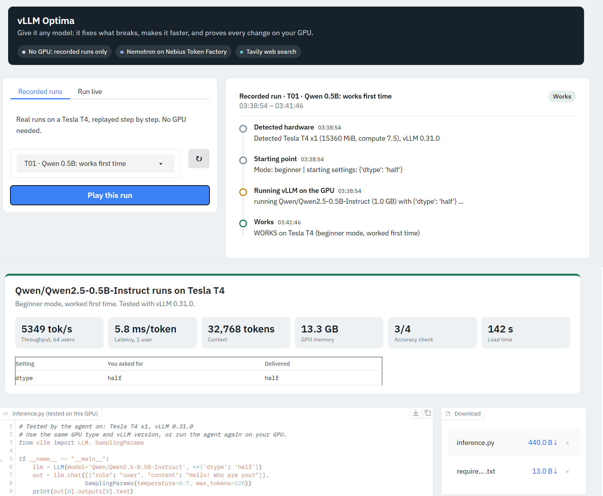
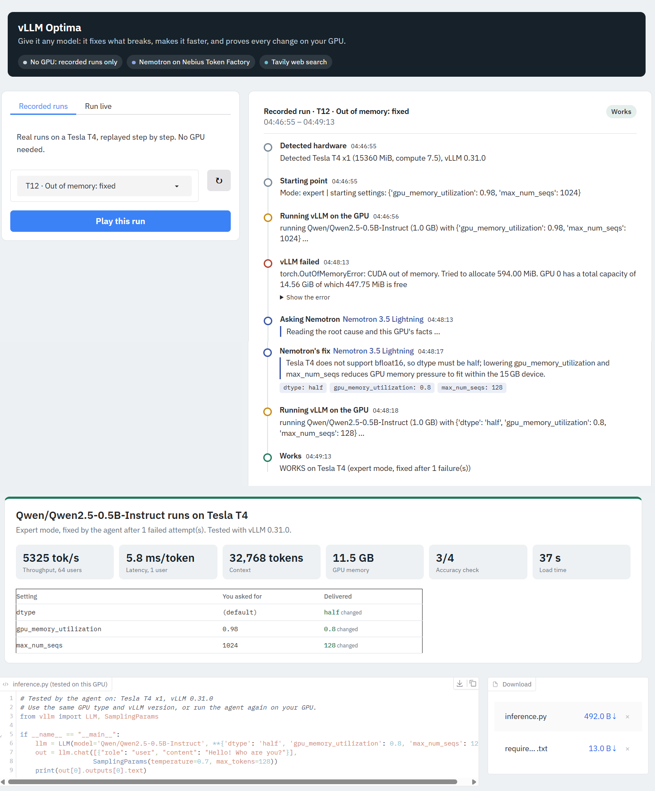
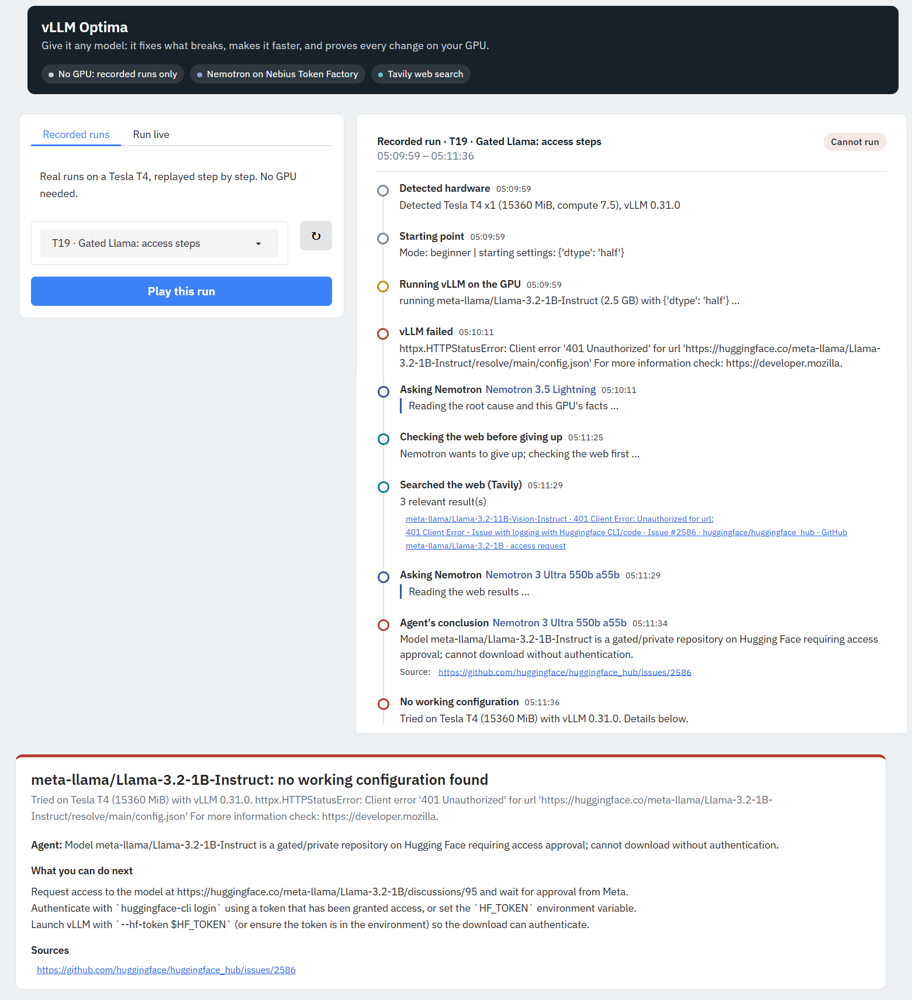
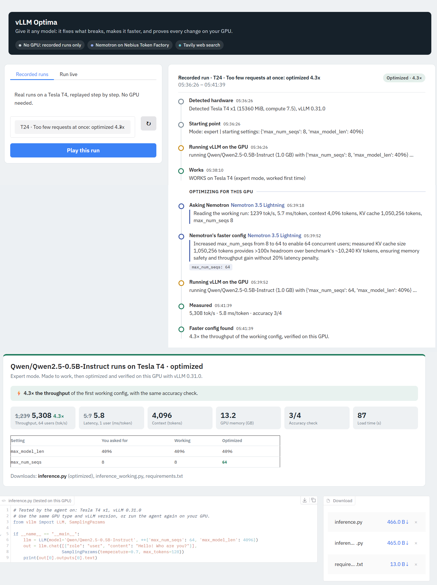
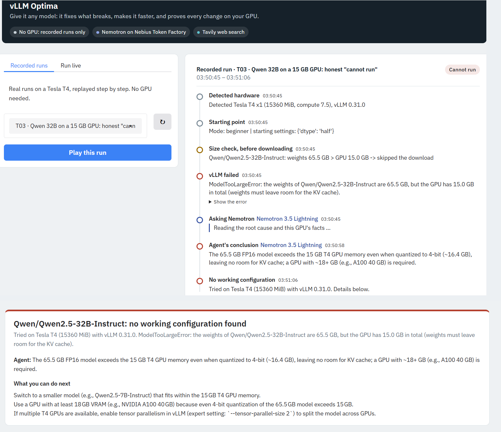

<div align="center">

# vLLM Optima

### Self-healing, hardware-aware optimizer for LLM serving

**Give it any model: it fixes what breaks, makes it faster, and proves every change on your GPU.**

[**▶ Live demo (recorded runs)**](LINK_TO_HF_SPACE) &nbsp;·&nbsp;
[**Open in Colab**](LINK_TO_COLAB) &nbsp;·&nbsp;
[**3-min video**](LINK_TO_YOUTUBE) &nbsp;·&nbsp;
[**Test plan (30 cases)**](docs/vllm_optima_test_plan.xlsx)

Built for the **Nebius × NVIDIA Global AI Hackathon** · Track: *Coding and Agentic Engineering*
Powered by **NVIDIA Nemotron** on **Nebius Token Factory** · Web search by **Tavily** · Serving engine: **vLLM**

</div>

---

## At a glance

| | |
|---|---|
| **Input** | A Hugging Face model name, and optionally your own vLLM settings |
| **Output** | A tested `inference.py`, a `requirements.txt`, and measured throughput, latency, memory, context and accuracy. If nothing can work, an honest answer with the reason and sources |
| **Brain** | NVIDIA Nemotron 3.5 Lightning (fast first fixes) + Nemotron 3 Ultra (hard cases, second opinions), served by Nebius Token Factory |
| **Proof** | Every proposed change is run on the real GPU and measured. The model proposes; only the measurements decide |
| **Tested** | 30 scenarios on a Tesla T4 → **29 passed, 0 failed** (1 not run); **29 recorded runs** anyone can replay without a GPU |
| **Best results** | **4.3×** throughput on a throttled config · **3.4×** by removing a slow user setting · **2.0×** on a 7B model · context **8,192 → 12,000** tokens at the same speed |

---

## Contents

1. [Background: LLMs and vLLM](#1-background-llms-and-vllm)
2. [The problem](#2-the-problem-running-a-model-on-your-gpu-is-trial-and-error)
3. [Why vLLM, not TensorRT-LLM, for this demo](#3-why-vllm-not-tensorrt-llm-for-this-demo)
4. [What vLLM Optima does](#4-what-vllm-optima-does)
5. [Architecture](#5-architecture)
6. [How NVIDIA Nemotron and Nebius Token Factory are used](#6-how-nvidia-nemotron-and-nebius-token-factory-are-used)
7. [See it work: five runs](#7-see-it-work-five-runs)
8. [Results](#8-results)
9. [Prior work and how this differs](#9-prior-work-and-how-this-differs)
10. [Run it yourself](#10-run-it-yourself)
11. [Design principles](#11-design-principles-honesty-and-safety)
12. [Limitations and roadmap](#12-limitations-and-roadmap)
13. [Repository layout](#13-repository-layout)

---

## 1. Background: LLMs and vLLM

**What is an LLM?** A large language model (LLM) is a neural network trained on large amounts of text to predict the next token. Models like Qwen, Llama, Phi and NVIDIA Nemotron power chat assistants, coding tools and agents. Open-weight models can be downloaded from Hugging Face and run on your own hardware, but *serving* them efficiently is an engineering problem of its own.

**What is vLLM?** [vLLM](https://github.com/vllm-project/vllm) is one of the most widely used open-source engines for serving LLMs. Its key ideas:

- **PagedAttention:** stores the attention key/value cache (the KV cache) in small blocks, like virtual memory, so GPU memory isn't wasted and many requests fit at once.
- **Continuous batching:** new requests join a running batch immediately instead of waiting, which raises throughput.
- **CUDA graphs and torch.compile:** reduce per-step overhead.
- **Easy to use:** loads Hugging Face models directly and offers an OpenAI-compatible server.

vLLM exposes **hundreds of engine settings** (`dtype`, `gpu_memory_utilization`, `max_model_len`, `max_num_seqs`, `max_num_batched_tokens`, `kv_cache_dtype`, `quantization`, `tensor_parallel_size`, `compilation_config`, …). Getting them right for *your* model on *your* GPU is where the trouble starts.

---

## 2. The problem: running a model on your GPU is trial and error

Every one of these failures came up while building this project on a Tesla T4:

| Limitation | What you see | Why it happens |
|---|---|---|
| **GPU feature gaps** | `bfloat16 is not supported`, `FP8 KV cache is not supported` | Older GPUs (compute 7.5) lack bf16 and FP8. A config copied from an H100 breaks |
| **Memory limits** | `CUDA out of memory`, "KV cache too small for max_model_len" | Settings too aggressive for 15 GB, or the default 32k context doesn't fit |
| **Fast-moving API** | `unexpected keyword argument 'max_seq_len_to_capture'` | Settings get renamed or removed between vLLM releases, so old configs and blog posts break |
| **Cryptic errors** | `not enough values to unpack`, compiler-backend crashes | The real cause is buried among hundreds of log lines |
| **Misleading noise** | `ERROR … FA2 is only supported on compute capability >= 8` in *successful* runs | Harmless fallbacks are printed as errors |
| **Model-specific blockers** | GPT-2 has no chat template; gated Llama needs access; InternLM needs custom code | Not a settings problem at all, but you only find out after a slow load |
| **Silent slowness** | A config that "works" but runs 2–4× slower than it could | Defaults and copied settings aren't tuned for your GPU or workload |

Each failed attempt costs minutes of model loading, then a search through logs, GitHub issues and forums. **vLLM Optima automates that whole loop.**

---

## 3. Why vLLM, not TensorRT-LLM, for this demo

[TensorRT-LLM](https://github.com/NVIDIA/TensorRT-LLM) is NVIDIA's high-performance inference library and often the fastest choice on recent NVIDIA GPUs. For this demo, vLLM was the better fit:

1. **Hardware we could test on.** The TensorRT-LLM [support matrix](https://nvidia.github.io/TensorRT-LLM/legacy/reference/support-matrix.html) lists Ampere, Ada Lovelace, Hopper and Blackwell GPUs. Turing (the free Colab T4) isn't listed, and unlisted architectures aren't developed or tested by the TensorRT-LLM team. vLLM runs on the T4, so anyone can reproduce our results for free.
2. **The T4 is the hardest test.** No bf16, no FP8, 15 GB of memory: it's where copied configs break most often, which is exactly what the agent has to handle.
3. **Direct Hugging Face loading.** vLLM serves a model straight from its Hugging Face name, so a run starts in under a minute. That keeps the agent's run → fix → re-run loop fast.
4. **Where developers are.** vLLM is among the most widely deployed open-source serving engines, so the problems it solves affect many people.

**TensorRT-LLM is the next engine, not a rejected one.** The agent loop is engine-agnostic: detect hardware → run → extract the root cause → Nemotron proposes → re-run and measure. Adding TensorRT-LLM means a new harness and a new set of known errors, not a new design.

---

## 4. What vLLM Optima does

| | |
|---|---|
| 🔧 **Fix** | Runs vLLM on your GPU. When it fails, it extracts the root cause from the log and Nemotron changes **only what is broken**. Your own settings are kept wherever they work |
| ⚡ **Optimize** | One click on **"Optimize for this GPU"**. Nemotron reads the measured speed and engine values (KV-cache tokens, `max_num_seqs`, batched tokens, memory) and proposes a faster config. It's kept **only if it measures better** |
| ✅ **Prove** | Every config is run and measured on the real GPU. When nothing can work, you get an honest answer with the reason, sources and next steps, not a guess |

**Two modes:**
- **Beginner:** enter just a model name. The agent starts from vLLM defaults plus hardware-aware adjustments (e.g. `dtype: half` on a T4).
- **Expert:** paste your own settings. The agent keeps your intent and changes only what breaks, with a "requested vs delivered" table explaining every change.

---

## 5. Architecture



**The loop, step by step**

1. **Detect** the GPU (`nvidia-smi`): name, memory, compute capability, count, plus the vLLM version.
2. **Size check:** skip downloads that can't fit (e.g. a 65 GB model on a 15 GB GPU).
3. **Run** vLLM in a separate process and virtual environment, with a fixed workload: 64 requests × 128 tokens, a latency test and 4 accuracy questions.
4. **Diagnose:** pull the real error out of the log and ignore harmless noise.
5. **Fix:** known errors and saved lessons apply instantly. Otherwise Nemotron 3.5 Lightning proposes a fix; if that fails, Nemotron 3 Ultra takes over, with Tavily web results from attempt 2 onwards.
6. **Verify:** re-run vLLM. Up to 4 attempts, then an honest give-up (after one last web check).
7. **Deliver:** `inference.py` generated from the exact settings that passed, plus `requirements.txt` and metrics.
8. **Learn:** the solved error is saved to `lessons.json`, so the next run skips straight to the fix.
9. **Optimize (optional):** propose → run → measure → keep only if better. Ultra gives a second opinion before accepting "already the fastest".

---

## 6. How NVIDIA Nemotron and Nebius Token Factory are used

All reasoning runs on **NVIDIA Nemotron through Nebius Token Factory** (OpenAI-compatible API: `https://api.tokenfactory.nebius.com/v1/`).

| Model | Role in the agent |
|---|---|
| **`nvidia/Nemotron-3_5-Lightning`** | First fix attempt for every error · first optimization proposal · handles routine errors in seconds |
| **`nvidia/Nemotron-3-Ultra-550b-a55b`** | Takes over when a fix fails · second opinion when Lightning says "already the fastest" · writes grounded next steps for give-ups |

**What Nemotron sees:** the GPU facts, the root-cause error, the current settings, previous attempts, the known-fixes skill file, saved lessons, Tavily results when present, and (for optimization) the measured workload and engine values.

**What Nemotron returns:** a JSON object with *only the changes*, plus a one-sentence reason, or a give-up with the reason.

**What Nemotron never does:** decide whether a fix worked. The harness runs vLLM and measures. A fix that changes nothing is rejected, and the agent never enables `trust_remote_code` on its own.

**Tavily** is used for errors the agent doesn't know: from the second attempt, at once if the user ticks "search first", and always once before giving up. Sources are shown as links in the timeline.

---

## 7. See it work: five runs

All screenshots are from real runs on a Tesla T4. Each one can be replayed in the [live demo](LINK_TO_HF_SPACE).

### 7.1 Works first time (beginner mode)
<!-- SCREENSHOT: docs/images/01_default.png  (recording T01_small_model) -->


`Qwen/Qwen2.5-0.5B-Instruct`, model name only. vLLM defaults plus `dtype: half` for the T4: **works first time, 5,349 tok/s, 5.8 ms/token, 32k context**. No Nemotron call is needed when nothing breaks.

### 7.2 Out of memory → fixed
<!-- SCREENSHOT: docs/images/02_oom.png  (recording T12_out_of_memory) -->


Expert settings `gpu_memory_utilization: 0.98, max_num_seqs: 1024` crash with CUDA out of memory. Nemotron lowers them to **0.8 and 128**, and the agent verifies **5,325 tok/s**: fixed without being over-cautious.

### 7.3 Unknown error → web search → answer with sources
<!-- SCREENSHOT: docs/images/03_tavily.png  (recording T19_gated_llama) -->


`meta-llama/Llama-3.2-1B-Instruct` is a gated model. One vLLM run fails, and before giving up the agent checks the web: **Tavily finds 3 relevant results**. The agent stops with the real reason (the repository needs access approval), next steps and a source link, and no wasted re-runs.

### 7.4 Optimize for this GPU → 4.3× faster, verified
<!-- SCREENSHOT: docs/images/04_optimize.png  (recording T24_opt_4x) -->


A working but throttled config (`max_num_seqs: 8`). One click on **Optimize**: Nemotron reads the measured numbers, proposes one change, and the agent measures **1,239 → 5,308 tok/s (4.3×)** before accepting it.

### 7.5 Honest give-up
<!-- SCREENSHOT: docs/images/05_give_up.png  (recording T03_32b_cannot_run) -->


`Qwen/Qwen2.5-32B-Instruct` on a 15 GB GPU. The size check skips the 65.5 GB download, and Nemotron confirms that even a 4-bit version (~16.4 GB) leaves no room for the KV cache. Instead of a crash loop, the agent says **"no working configuration found"**, with the reason and the fix: a GPU with ~18 GB or more.

### What you get at the end of a run

```python
# Tested by the agent on: Tesla T4 x1, vLLM 0.31.0
# Use the same GPU type and vLLM version, or run the agent again on your GPU.
from vllm import LLM, SamplingParams

if __name__ == "__main__":
    llm = LLM(model='Qwen/Qwen2.5-0.5B-Instruct', **{'dtype': 'half', 'gpu_memory_utilization': 0.8, 'max_num_seqs': 64})
    out = llm.chat([{"role": "user", "content": "Hello! Who are you?"}],
                   SamplingParams(temperature=0.7, max_tokens=128))
    print(out[0].outputs[0].text)
```

This file was also run on its own, unchanged, with plain vLLM on the T4, and printed a correct reply.

---

## 8. Results

**Test setup:** Google Colab, Tesla T4 (15 GB, compute 7.5), vLLM 0.31.0. The full plan with inputs, expected and actual results is in [`docs/vllm_optima_test_plan.xlsx`](docs/vllm_optima_test_plan.xlsx). Each row links to its recording (`T01`–`T29`).

| Group | Tests | Result |
|---|---|---|
| Core (dtypes, FP8, H100 config, OOM, compiler crash, context, model families) | 13 | 13 passed |
| Web search and honest answers (GPT-2, custom code, gated model, removed settings) | 6 | 6 passed |
| Lessons (same error twice → no second search) | 1 | 1 passed |
| Optimizer | 9 | 9 passed |
| Replay without GPU | 1 | not run in Colab (all 29 recordings replay offline) |
| **Total** | **30** | **29 passed · 0 failed · 1 not run** |

**Optimizer: verified gains**

| Run | Before | After | Gain |
|---|---|---|---|
| `T24` Too few requests at once (Qwen 0.5B) | 1,239 tok/s | 5,308 tok/s | **4.3×** |
| `T25` CUDA graphs off (`enforce_eager`) | 1,621 tok/s | 5,483 tok/s | **3.4×** |
| `T27` Qwen 7B (4-bit AWQ), throttled | 451 tok/s | 914 tok/s | **2.0×** |
| `T22` Phi-3.5 context-limited | 8,192 tokens | 12,000 tokens | **+46% context**, same speed |
| `T21`, `T23`, `T28` already fast | – | – | Kept honestly: candidates measured, none better |

Models covered: **6 families from 0.5B to 32B** (Qwen2.5, Phi-3.5, SmolLM2, Llama 3.2, InternLM 2.5, GPT-2).

---

## 9. Prior work and how this differs

### Research on agent-driven deployment

| Work | What it does | How vLLM Optima differs |
|---|---|---|
| **AIPC**: *Agent-Based Automation for AI Model Deployment with Qualcomm AI Runtime* (Su et al., [arXiv:2604.14661](https://arxiv.org/abs/2604.14661)) | LLM agents with skills, helper scripts and stage-wise validation convert PyTorch models (e.g. Real-ESRGAN, YOLOv8, YOLO-World, Whisper) to Qualcomm QNN/SNPE; checked against PyTorch outputs | Targets **LLM serving**, not model conversion; tunes a running engine for **speed** as well as "does it run" |
| *From PyTorch to the NPU: LLM-Agent-Driven Model Conversion Across Heterogeneous Inference Runtimes* (Su et al., [arXiv:2609.27249](https://arxiv.org/abs/2609.27249)) | Extends AIPC to OpenVINO, RKNN, TensorRT and ONNX Runtime with staged verification loops; vision models, FP16 feasibility | Same "skills + verification loop" spirit, applied to **LLM serving configs** on the user's own GPU, with **measured** throughput, latency, memory and accuracy |
| *From Human Guidance to Autonomy: Agent Skill System for End-to-End LLM Deployment on Spatial NPUs* (Li et al., Cornell/AMD, [arXiv:2606.07586](https://arxiv.org/abs/2606.07586)) | An 8-phase agent skill system deploys 9 small LLMs on the AMD XDNA 2 NPU, writing low-level code; 0.5–4 h of agent time per model | Works at the **serving-config level** on commodity NVIDIA GPUs, in **minutes**, for any Hugging Face model, and also handles honest give-ups and user intent |

### Tools for tuning LLM serving

| Tool | What it does | How vLLM Optima differs |
|---|---|---|
| **NVIDIA AIConfigurator** (Dynamo) | Recommends deployment configs (parallelism, prefill/decode workers) for SLA targets; [results are estimates](https://docs.nvidia.com/dynamo/v-0-8-1/user-guides/finding-best-initial-configs.md); TensorRT-LLM backend on H100/H200/A100 | Runs and **measures** on the actual GPU; **fixes failures**; works on any GPU vLLM supports, including a T4 |
| **NVIDIA NIM** | Prebuilt, optimized inference containers for supported models and GPUs | Works on **any** Hugging Face model and **your** settings, and explains every change |
| **Benchmark tools** (e.g. NVIDIA AIPerf / GenAI-Perf) | Measure the performance of a running endpoint | Measuring is one step of the loop. Optima also diagnoses, fixes and tunes |
| **vLLM auto-tune scripts / "vLLM Optimizer"** | Sweep settings on configs that already run | Starts from **broken** configs, uses reasoning instead of blind sweeps, keeps user intent, and accepts a change **only when measured better** |

**In one line:** existing tools either assume the model already runs, or estimate instead of measuring. vLLM Optima starts from *"it crashed"* and ends at *"here is the fastest config we proved on your GPU"*.

---

## 10. Run it yourself

### Option A: replay demo (no GPU, no keys)
Open the [**live demo**](LINK_TO_HF_SPACE), choose any of the 29 recorded runs, and watch the agent work step by step.

### Option B: Google Colab (free T4, ~10 min first-time setup)

[](LINK_TO_COLAB)

1. **Choose a GPU:** *Runtime → Change runtime type → T4 GPU*.
2. **Add your keys** in Colab **Secrets** (🔑 icon on the left):
   - `NEBIUS_API_KEY`: required ([Nebius Token Factory](https://tokenfactory.nebius.com))
   - `TAVILY_API_KEY`: optional (web search for unknown errors)
3. **Run the cells in order:**

   ```python
   # 1. Check the GPU
   !nvidia-smi --query-gpu=name,memory.total,compute_cap --format=csv
   ```
   ```python
   # 2. Get the code, and install vLLM in its own environment (takes a few minutes)
   !git clone LINK_TO_REPO vllm-optima
   !pip install -q uv
   !uv venv /content/vllm-env --python 3.12
   !uv pip install --python /content/vllm-env/bin/python vllm==0.31.0
   !pip install -q -r vllm-optima/app/requirements.txt
   ```
   ```python
   # 3. Load keys from Colab Secrets (never paste keys into the notebook)
   import os
   from google.colab import userdata
   os.environ["NEBIUS_API_KEY"] = userdata.get("NEBIUS_API_KEY")
   try:
       os.environ["TAVILY_API_KEY"] = userdata.get("TAVILY_API_KEY")
   except Exception:
       pass   # web search stays off
   ```
   ```python
   # 4. Launch the app (prints a public gradio.live link)
   %cd vllm-optima/app
   import app
   app.demo.queue().launch(share=True)
   ```
4. **Open the link** and try a model, e.g. `Qwen/Qwen2.5-0.5B-Instruct`, or paste a broken config such as `{"dtype": "bfloat16", "kv_cache_dtype": "fp8"}` and watch the agent fix it.

> [!TIP]
> If Colab has no free T4 available, Option A still shows every scenario.

### Option C: your own NVIDIA GPU
```bash
git clone LINK_TO_REPO && cd vllm-optima/app
python -m venv ~/vllm-env && ~/vllm-env/bin/pip install vllm==0.31.0
pip install -r requirements.txt
export VLLM_PYTHON=~/vllm-env/bin/python NEBIUS_API_KEY=...  TAVILY_API_KEY=...   # Tavily optional
SHARE=1 python app.py
```

---

## 11. Design principles: honesty and safety

- **Measured, not claimed.** Success is decided by running vLLM, never by the model saying it fixed something.
- **Minimal change.** In expert mode only broken settings change; a "requested vs delivered" table explains each one.
- **Honest give-ups.** No crash loops: when nothing can work, the agent says why, with sources.
- **Guardrails on optimization.** A candidate must be ≥ 1.05× faster, or give more context at ≥ 0.97× speed. Latency may not rise more than 20%, and accuracy may not drop. Invalid combinations are rejected before running. `enforce_eager` is never added (it disables CUDA graphs and was measured 3.4× slower).
- **Safe by default.** The agent never enables `trust_remote_code` itself (you can, as your own setting). API keys are read only from environment variables or secrets, and never logged.
- **No wasted runs.** Fixes that change nothing are rejected, and models that can't fit are skipped before downloading.

---

## 12. Limitations and roadmap

**Known limitations**
- Tested on one GPU type (Tesla T4) and vLLM 0.31.0. Results on other GPUs need a fresh run, which is what the agent is for.
- Nemotron's answers can vary between runs: a fix is always valid (it's measured) but not always the maximum. For example, a context of 8,192 was accepted where ~12,000 fit; the optimizer recovers it.
- The optimizer tunes for a fixed workload (64 requests × 128 tokens). Real traffic may differ.

**Roadmap**
- **TensorRT-LLM** as a second engine, using the same loop.
- **Bigger GPUs:** H100, L40S and multi-GPU (tensor parallel) on Nebius AI Cloud.
- **Custom workloads:** tune for your own prompt lengths and latency targets.
- **pip package and CLI:** `vllm-optima fix <model>` in CI pipelines.

---

## 13. Repository layout

```
vllm-optima/
├── app/
│   ├── app.py              # Gradio UI: live runs, Optimize button, recorded-run replay
│   ├── agent.py            # The agent loop: Nemotron, Tavily, lessons, optimizer
│   ├── test_run.py         # GPU harness: runs vLLM and measures (separate process)
│   ├── requirements.txt
│   └── recordings/         # 29 recorded runs (T01–T29), one per test
├── colab/
│   └── quickstart.ipynb    # 4-cell Colab notebook
├── docs/
│   ├── images/             # Screenshots used in this README
│   ├── vllm_optima_test_plan.xlsx
│   └── architecture.png
├── LICENSE                 # MIT
└── README.md
```

---

## Acknowledgements

- **NVIDIA** for the Nemotron models and **Nebius** for Token Factory, the reasoning behind every fix.
- **Tavily** for web search.
- The **vLLM** project. vLLM Optima is an independent project built on vLLM and isn't affiliated with the vLLM project.

## License

[MIT](LICENSE)
